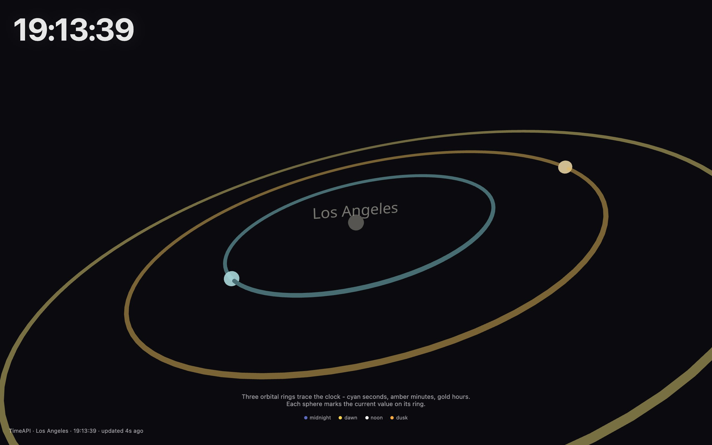

<div align="center">

<h1>orbiter</h1>

<p><b>A clock built as a 3D orrery.</b></p>

<p><i>Three rings for seconds, minutes and hours, each with a small moon set to the current Los Angeles time.</i></p>

<h6>


</h6>

<a href="https://orbiter.parthchandak.info"><b>Live demo</b></a> ·
<a href="#how-it-works"><b>How it works</b></a> ·
<a href="#run-it"><b>Run it</b></a>

<br><br>

<a href="https://orbiter.parthchandak.info"></a>

<sub>Live capture, 22 October 2026, at 19:13:39 Los Angeles time.</sub>

</div>

<br>

A clock face laid flat in space and seen from above at an angle. The page asks
[TimeAPI.io](https://timeapi.io) for the current time in `America/Los_Angeles`, then counts
forward locally every frame, so the spheres move smoothly between fetches. Drag to orbit the
camera and scroll to zoom.

## How it works

| Ring | Radius | Sphere goes round once per |
|---|---|---|
| Seconds (cyan) | 3 | minute |
| Minutes (amber) | 5 | hour |
| Hours (gold) | 7 | 12 hours |

- The time is re-fetched every 60 seconds; between fetches it is interpolated from
  `performance.now()`.
- If TimeAPI.io is unreachable the page falls back to the browser's own clock, converted to Los
  Angeles time, and the stamp in the bottom-left says `fallback` instead of `TimeAPI`.
- The large `HH:MM:SS` readout in the top-left updates every frame.
- Click any sphere for a panel with the time zone, weekday, the raw `dateTime` from the API and
  a link to the API response. It hides after four seconds.
- The rings drift slowly around the vertical axis. With `prefers-reduced-motion` they hold
  still and the star field stops.

## Run it

```bash
git clone https://github.com/parthchandak02/orbiter.git
cd orbiter
npm install
npm run dev      # local dev server
npm run build    # static site in dist/
```

The live version runs on Cloudflare Pages. No API key is needed.

<details>
<summary><b>Project layout</b></summary>

```
src/App.tsx                       Canvas, camera, OrbitControls, 60 s polling
src/data/time.ts                  API URL, colours, fetch, fallback and interpolation
src/components/OrbitalSystem.tsx  The three rings, their spheres and the city label
src/components/Background.tsx     Star field, fog and the central glow
src/components/HeroTime.tsx       The large time readout
src/components/QuietZone.tsx      The panel shown after a sphere click
brief.md                          The original creative brief
```

</details>

<br>

<div align="center">
<sub>Built with React Three Fiber, drei, Three.js and Vite. Time from TimeAPI.io.</sub>
</div>
